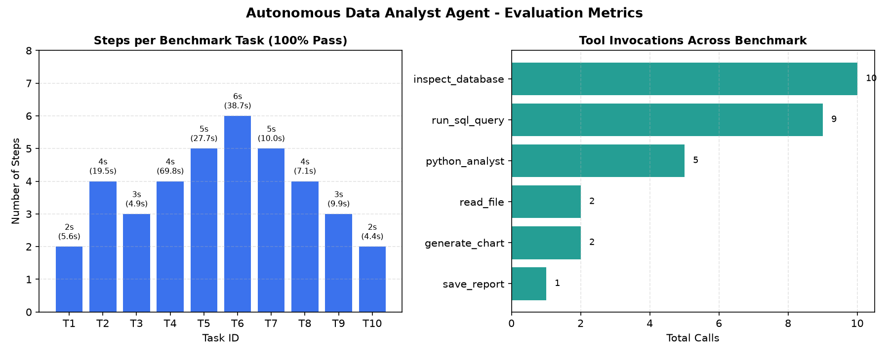

# Autonomous Data Analyst AI Agent

An autonomous, multi-step AI Agent built from scratch in Python using **Gemini (`gemini-3.1-flash-lite`)** and a custom **ReAct-style execution loop**. The agent inspects SQLite schemas and sample rows, runs read-only SQL queries, reads workspace files (`CSV`, `JSON`, `TXT`, `MD`), executes isolated Python/Pandas analytics, generates PNG charts, saves Markdown reports, and logs structured JSON execution traces.

---

## Repository Structure

- `src/agent.py`: Custom ReAct loop, loop detection, retry, and JSON trace logger
- `src/tools.py`: SQLite, Python/Pandas, file reader, chart, and report tools
- `src/setup_db.py`: SQLite database initialization and sample dataset
- `evaluations/run_benchmark.py`: 12-task benchmark across difficulty tiers and edge cases
- `evaluations/plot_benchmark.py`: Generates `benchmark_summary.png` from JSON traces
- `evaluations/test_tools.py`: Unit and security tests for tools and guardrails
- `reports/charts/`: Generated PNG visualizations
- `reports/*.md`, `*.csv`, `*.json`: Generated reports and sample input files
- `logs/`: Structured JSON execution traces
- `requirements.txt`, `.gitignore`, `README.md`

---

## Tools & Capabilities

1. `inspect_database()`: Returns table names, SQL schemas, and sample rows from `company_sales.db` so queries match exact column names and value formats.
2. `run_sql_query(query)`: Executes read-only `SELECT` SQLite queries and blocks destructive or non-`SELECT` statements.
3. `python_analyst(code)`: Runs Python (`pandas`, `numpy`, math) in a timeout-guarded subprocess (`8s`) with a restricted environment and static safety checks.
4. `read_file(filepath, max_rows)`: Reads workspace `CSV`, `JSON`, `TXT`, and `MD` files safely within the project directory.
5. `generate_chart(...)`: Renders `bar`, `barh`, `line`, and `pie` PNG charts under `reports/charts/`.
6. `save_report(filename, content)`: Saves Markdown reports under `reports/`.

---

## Evaluation & Visualizations

- **Unit & Security Suite (`evaluations.test_tools`)**: Verifies SQL read-only enforcement, restricted Python construct blocking, workspace path-traversal protection, and chart generation.
- **Multi-Step Benchmark (`evaluations.run_benchmark`)**: Evaluates 12 tasks across Easy, Medium, Hard, and Edge Cases (**100.0% pass rate**, **3.67 average steps**, **18.15s average latency**), including multi-source `CSV`/`JSON` + SQL joins, automatic chart error recovery, and loop guardrail stress testing.

---

## Guardrails & Error Handling

- **Loop Detection**: Tracks `tool_name:sorted_args` signatures and injects a system warning when identical calls repeat, paired with a `max_steps` cap.
- **Self-Correction on Empty/Invalid Results**: Returns clear error or empty-set messages so the agent can inspect schemas/samples and refine queries or tool arguments.
- **Resilience & Language Matching**: Includes HTTP timeouts, `429` retry backoff, and responds in the user prompt language (Arabic or English).

---

## Quick Start

1. Activate virtual environment, install dependencies (`pip install -r requirements.txt`), and set `GEMINI_API_KEY`.
2. Initialize database and run tool unit tests: `python src/setup_db.py` then `python -m evaluations.test_tools`.
3. Run single agent task, full benchmark, and summary chart: `python -m src.agent`, `python -m evaluations.run_benchmark`, and `python -m evaluations.plot_benchmark`.
